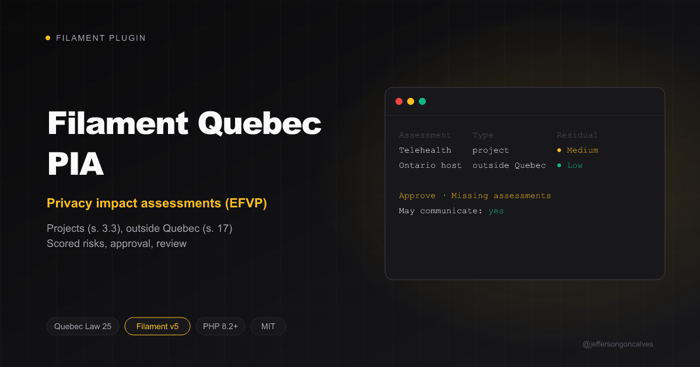

<div class="filament-hidden">



</div>

# Filament Quebec PIA

[](https://packagist.org/packages/jeffersongoncalves/filament-quebec-pia)
[](https://github.com/jeffersongoncalves/filament-quebec-pia/actions?query=workflow%3Atests+branch%3A3.x)
[](https://github.com/jeffersongoncalves/filament-quebec-pia/actions?query=workflow%3A"Fix+PHP+code+styling"+branch%3A3.x)
[](https://packagist.org/packages/jeffersongoncalves/filament-quebec-pia)
[](LICENSE.md)

Write the privacy impact assessments (EFVP) of [laravel-quebec-pia](https://github.com/jeffersongoncalves/laravel-quebec-pia) in your Filament panel, under Quebec's private sector privacy act (Law 25).

## Features

- Assessments of three types: an information system project (s. 3.3), a communication outside Quebec (s. 17) or research (s. 21), linked to a processing activity from [laravel-quebec-governance](https://github.com/jeffersongoncalves/laravel-quebec-governance).
- The description, the necessity and proportionality, and the opinion of the person in charge of the protection of personal information, consulted from the outset.
- Outside Quebec: the destination, its legal framework and the conclusion on adequate protection; a **May communicate** column shows when the information may go.
- Risks in a repeater. Each one has an optional LINDDUN threat, a likelihood and an impact from 1 to 3, the measures taken, and the scores after those measures.
- **Approve:** asks for the approver's name and schedules the next review. Editing an approved assessment sends it back to draft.
- **Missing assessments:** lists the processing activities with sensitive information or profiling and no project assessment, or communicated outside Quebec without an outside-Quebec assessment.
- **Export (JSON)** for each assessment.
- 19 languages.

## Compatibility

| Plugin Version                                                           | Filament |
|--------------------------------------------------------------------------|----------|
| [1.x](https://github.com/jeffersongoncalves/filament-quebec-pia/tree/1.x) | 3.x      |
| [2.x](https://github.com/jeffersongoncalves/filament-quebec-pia/tree/2.x) | 4.x      |
| [3.x](https://github.com/jeffersongoncalves/filament-quebec-pia/tree/3.x) | 5.x      |

## Installation

You can install the package via composer:

```bash
composer require jeffersongoncalves/filament-quebec-pia:"^3.0"
php artisan vendor:publish --tag="quebec-governance-migrations"   # if not published yet
php artisan vendor:publish --tag="quebec-pia-migrations"
php artisan migrate
```

## Usage

```php
use JeffersonGoncalves\Filament\QuebecPia\QuebecPiaPlugin;

public function panel(Panel $panel): Panel
{
    return $panel
        ->plugins([
            QuebecPiaPlugin::make()
                ->navigationGroup('Quebec')             // default: no group
                ->navigationSort(7)
                ->navigationIcon('heroicon-o-shield-exclamation')
                ->slug('impact-assessments'),
        ]);
}
```

All fluent methods are optional. Pair it with [filament-quebec-governance](https://github.com/jeffersongoncalves/filament-quebec-governance) to maintain the processing activities in the same panel.

> The resource has no authorization of its own: register it only on panels whose users write the assessments, or add a policy for `JeffersonGoncalves\QuebecPia\Models\ImpactAssessment`.

## Testing

```bash
composer test
```

## Changelog

Please see [CHANGELOG](CHANGELOG.md) for more information on what has changed recently.

## Contributing

Please see [CONTRIBUTING](.github/CONTRIBUTING.md) for details.

## Security Vulnerabilities

Please review [our security policy](../../security/policy) on how to report security vulnerabilities.

## Credits

- [Jefferson Gonçalves](https://github.com/jeffersongoncalves)
- [All Contributors](../../contributors)

## License

The MIT License (MIT). Please see [License File](LICENSE.md) for more information.
